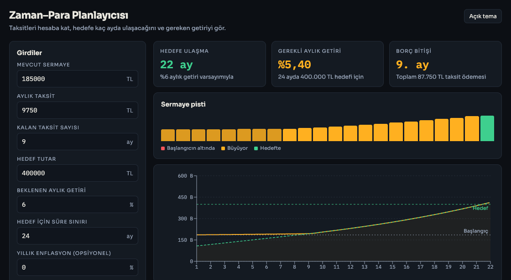
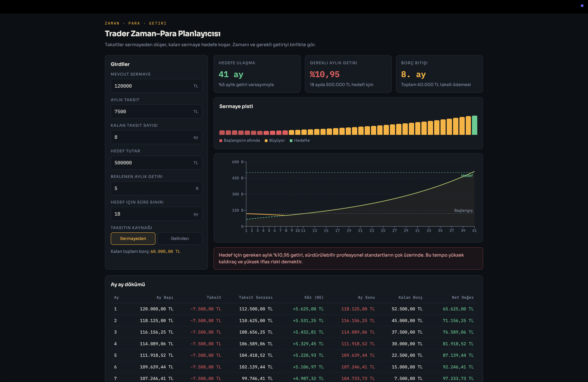

# Zaman–Para Planlayıcısı

Taksitleri öderken hedefe kaç ayda ulaşacağını ve belirli bir süre için gereken aylık getiriyi hesaplayan yerel React simülasyonu.

<picture>
  <source media="(prefers-color-scheme: light)" srcset="screenshots/01-hedefe-ulasiliyor-acik.png">
  
</picture>

Örnekte 185.000 TL sermaye, 9 ay boyunca 9.750 TL taksit ve aylık %6 varsayımıyla 400.000 TL hedefine 22 ayda ulaşılıyor.

## Ne yapar

- **Açık ve koyu tema.** İlk açılışta sistem tercihi kullanılır; elle seçilen tema bu tarayıcıda saklanır.

- **Ay ay simülasyon.** Her ay önce taksit sermayeden düşülür, kalan bakiye o ayın getirisiyle büyür. Sıralama önemlidir — önce ödeme, sonra kâr.
- **Hedefe ulaşma süresi.** Girdiğin getiri varsayımıyla hedefe kaçıncı ayda varıldığı.
- **Gerekli aylık getiri.** Ters yönden çözer: verdiğin süre sınırı içinde hedefe varmak için ayda yüzde kaç gerekiyor? İkili arama ile bulunur.
- **Risk yorumu.** Gereken getiri bir eşiği aştığında araç seni uyarır. %10’un üzerindeki aylık getiri ayrı bir uyarıyla gösterilir.
- **Sermaye pisti.** Her ay bir çubuk: kırmızı = başlangıç sermayesinin altında, sarı = büyüyor, yeşil = hedefte. Planın nerede dibe vurup nerede toparladığı tek bakışta görünür.
- **İflas tespiti.** Taksit sermayeyi sıfırın altına indiriyorsa simülasyon durur ve bunu açıkça söyler.
- **Enflasyon (opsiyonel).** Yıllık enflasyon girildiğinde araç reel değerleri de gösterir: bugünkü alım gücüyle hedefe kaçıncı ayda varılır, reel hedef için ayda yüzde kaç gerekir. Boş bırakılırsa (0) tüm hesap nominaldir.
- **Senaryo karşılaştırma.** "Senaryoyu sabitle" düğmesi mevcut girdileri dondurur; sonra girdileri değiştirdikçe iki senaryo yan yana tabloda ve grafikte (mavi çizgi) karşılaştırılır. Sermayeden/Gelirden farkını görmenin en hızlı yolu budur.

## İki örnek senaryo

**Plan tutuyor** — 185.000 TL sermaye, 9 ay boyunca 9.750 TL taksit, 24 ayda 400.000 TL hedef. %6 getiri varsayımıyla hedefe 22. ayda ulaşılıyor; süre sınırı için gereken getiri %5,40.

**Yüksek risk** — 120.000 TL sermaye, 8 ay boyunca 7.500 TL taksit, 18 ayda 500.000 TL hedef. Gereken aylık getiri %10,95. Araç gereken getiriyi kırmızıyla işaretler.



İkinci ekran görüntüsündeki sermaye pisti aracın asıl anlattığı şeyi gösteriyor: ilk 8 ay sermaye başlangıcın altında (kırmızı), borç bitince toparlıyor. Borç bitene kadar geçen süre planın en kırılgan bölümüdür.

## Taksitin kaynağı

İki mod var ve fark büyüktür:

- **Sermayeden** — taksit yatırım sermayesinden çıkar. Bileşik büyüme her ay geriye çekilir.
- **Gelirden** — taksiti dışarıdan (maaş vb.) ödersin, sermaye dokunulmadan büyür.

Aynı hedef, ikinci modda çok daha erken gelir. Yukarıdaki ilk senaryoda hedef 22 ay yerine 14 ayda tutuyor. Taksiti sermayeden ödemenin gerçek maliyeti budur — ve senaryo karşılaştırma özelliği tam bunu yan yana göstermek için var: senaryoyu sabitle, kaynağı değiştir, farkı gör.

## Çalıştırma

Proje tek bir React bileşeninden oluşuyor (`zaman-para-planlayici.jsx`). Vite ile çalıştırmak için:

```bash
npm create vite@latest planlayici -- --template react
cd planlayici
npm install
npm install recharts
```

Ardından `zaman-para-planlayici.jsx` dosyasını `src/App.jsx` olarak kopyala ve dev sunucusunu başlat:

```bash
npm run dev
```

Bileşen stillerini kendi içinde taşır (`<style>` bloğu), tek dış bağımlılığı [Recharts](https://recharts.org)'tır.

## Varsayımlar ve sınırlar

Sayıları okurken bunları akılda tut:

- **Getiri sabit varsayılır.** Gerçek trading getirileri dalgalıdır. Ardışık kayıp ayları burada görünenden çok daha ağır sonuç doğurur, çünkü bileşik etki iki yönde de çalışır.
- **Taksitler eşit ve sabittir.** Değişken faizli ya da kademeli ödeme planları modellenmez.
- **Vergi ve komisyon hesaba katılmaz.**
- **Enflasyon varsayılan olarak kapalıdır.** Girilmediğinde hedef nominal TL'dir. Girildiğinde reel değerler ayrıca gösterilir, ama beklenen getiri varsayımın yine nominal getiridir — reel hesap sadece sonucu bugünkü alım gücüne çevirir.
- **Simülasyon 120 ayda kesilir.**

Bu bir planlama simülasyonudur, yatırım tavsiyesi değildir. Aracın asıl faydası hedefe ulaşmayı vaat etmesi değil, bazı hedeflerin gerektirdiği getirinin ne kadar gerçekdışı olduğunu göstermesidir.

---

## Geliştirici

**Mehmet Fatih Doğan** — yazılım geliştirici.

- 🌐 Portfolyo & iletişim: [mehmetfatihdogan.com.tr](https://mehmetfatihdogan.com.tr)
- 💻 GitHub: [@fatihdogann](https://github.com/fatihdogann)

Proje hakkında soru, hata bildirimi veya geri bildirim için [iletişim sayfamdan](https://mehmetfatihdogan.com.tr/iletisim) ulaşabilirsin.
